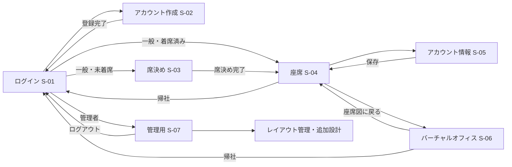
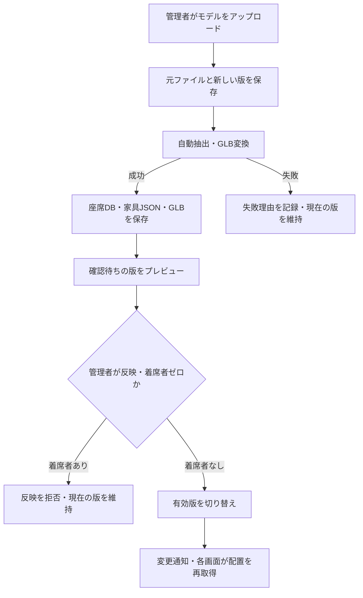
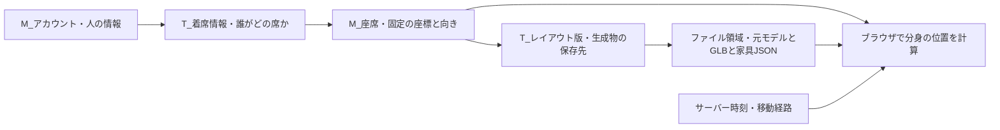

# 席替えアプリ 全体設計（仮版）

作成日：2026-10-26。現状の確認対象：`origin/main` の `f2fb79c`。

最新コードを読んだ整理と、管理画面からモデルをアップロードする追加設計をまとめる。実行確認は未実施。2026-10-26に作業フォルダのアプリ本体も `f2fb79c` に更新した。既存の `app-map.md` と `screen-map.md` は旧版資料であり、本資料の現状説明を優先する。

## 1. 概要と件数

利用者に空席を割り当て、2D座席図と3Dバーチャルオフィスで着席状況・プロフィールを共有する。管理者はお題とアカウントを管理する。追加設計では、管理画面からモデルをアップロードし、座席・家具配置を抽出して確認後に反映する。

| 対象 | 現在 | 今回の設計後 |
|---|---|---|
| 画面数 | 7画面 | 7画面。管理画面内にレイアウト管理を追加する案 |
| 機能数 | 本資料の数え方で19機能 | 24機能。モデル管理の5機能を追加 |
| DBテーブル数 | 5テーブル | 7テーブル。2追加、既存の座席を拡張 |

画面数は独立したHTML・URLで数える。タブ、ポップアップ、3D内の部屋は別画面に数えない。機能数はF-01～F-24の単位で数え、入力検証やボタン単位の処理は含めない。画面間で同じ機能を使っても重複計上しない。

## 2. 画面一覧と画面に対する機能

| ID | 画面名 | URL | 対象HTML | 機能IDと機能名 |
|---|---|---|---|---|
| S-01 | ログイン | `/` | `web/index.html` | F-01 ログイン |
| S-02 | アカウント作成 | `/register` | `web/register.html` | F-02 アカウント登録 |
| S-03 | 席決め | `/seat-change` | `web/seat-change.html` | F-03 プロフィール取得、F-06 席決め、F-07 座席図表示、F-11 今日のお題表示、F-19 画面同期 |
| S-04 | 座席 | `/seat` | `web/seat.html` | F-07 座席図表示、F-08 利用者情報表示、F-09 帰社、F-19 画面同期 |
| S-05 | アカウント情報 | `/account` | `web/account.html` | F-03 プロフィール取得、F-04 プロフィール更新、F-11 今日のお題表示、F-19 画面同期 |
| S-06 | バーチャルオフィス | `/office` | `web/office.html` | F-08 利用者情報表示、F-09 帰社、F-15 3D表示、F-16 視点操作、F-17 分身の自動移動、F-18 部屋切り替え、F-19 画面同期 |
| S-07 | 管理用 | `/admin` | `web/admin.html` | F-05 管理者追加、F-07 座席図表示、F-10 ログアウト、F-11 今日のお題表示、F-12 お題追加、F-13 お題編集、F-14 リセット、F-19 画面同期、追加のF-20～F-24 レイアウト管理 |

F-14は管理画面からの手動実行に加え、日本時間0時と必要時の起動補正で実行する。F-19の同期は画面に応じて再取得・再描画・遷移に使う共通機能。

### 画面遷移



レイアウト管理はS-07内の機能で、独立画面ではない。未ログイン、権限不足、未着席でのアクセスは `PageController` が利用者の状態に合う画面へ振り分ける。

## 3. 機能に対する処理とテーブル

M1～T7のテーブル記号は後述のテーブル一覧に対応する。既存APIは実装済みのパス、追加機能の処理は提案でありAPIパスは未決定。

| ID | 機能名 | 状態 | 処理の概要・入口 | 関連テーブル |
|---|---|---|---|---|
| F-01 | ログイン | 既存 | `POST /api/login` → `AccountService.authenticate()`。パスワード照合、失敗回数・ロック管理、セッション作成、状態に応じた画面遷移。 | M1 |
| F-02 | アカウント登録 | 既存 | `POST /api/register` → `AccountService.register()`。ID・パスワード検証、重複確認、BCryptハッシュ化、登録。 | M1 |
| F-03 | プロフィール取得 | 既存 | `GET /api/me`。名前・課題・取り組み・権限・着席状態・今日のお題を取得。 | M1、T5、M6、T7 |
| F-04 | プロフィール更新 | 既存 | `POST /api/account` → `AccountService.saveProfile()`。名前・課題・取り組みを検証して更新。 | M1 |
| F-05 | 管理者追加 | 既存 | `POST /api/admin/admins` → `AccountService.register()`。管理者フラグ付きのアカウントを登録。 | M1 |
| F-06 | ランダムな席決め | 既存・改修 | `POST /api/seat-change/assign` → `SeatingService.assign()`。名前を保存し、空席を抽選。競合時は選び直す。改修後は有効なレイアウト版の席に限定。 | M1、M4、T5。改修後はM2、T3も参照 |
| F-07 | 2D座席図表示 | 既存・改修 | `GET /api/seat-map` → `SeatingService.seatMap()`。`office-map2d.js`で配置と着席状態を表示。改修後は有効版の配置を利用。 | M1、M4、T5。改修後はM2、T3も参照 |
| F-08 | 利用者情報表示 | 既存 | `GET /api/seats/{seatId}/person` → `SeatingService.person()`。選択した席の利用者情報を取得。 | M1、T5 |
| F-09 | 帰社・座席解放 | 既存 | `POST /api/seat/leave`。着席情報を削除し、セッションを破棄してログイン画面へ移動。 | T5 |
| F-10 | ログアウト | 既存 | `POST /api/logout`。セッションを破棄する。着席情報の削除はF-09の役割。 | DB更新なし |
| F-11 | 今日のお題表示 | 既存 | 一般画面は `/api/me`、管理画面は `/api/admin/data` から当日のお題を取得。 | M6、T7 |
| F-12 | お題追加 | 既存 | `POST /api/admin/topics` → `TopicService.add()`。入力を検証して候補を登録。 | M6 |
| F-13 | お題編集 | 既存 | `PUT /api/admin/topics/{id}` → `TopicService.edit()`。候補の本文を更新。 | M6 |
| F-14 | 日次・手動リセット | 既存 | `DailyResetJob`。全員の着席を解除し、お題を選定。手動は `POST /api/admin/daily-reset`。 | T5、M6、T7 |
| F-15 | 3Dオフィス表示 | 既存・改修 | `office-view.js` がGLBと座席・家具JSONをロード。改修後は有効版のファイルと座席を使用。 | 現在はM1、M4、T5と静的ファイル。改修後はM2、T3も参照 |
| F-16 | 視点操作 | 既存 | `office-view.js`。回転、移動、拡大縮小、視点切り替えをブラウザで処理。 | なし |
| F-17 | 分身の表示・自動移動 | 既存 | `office-view.js`、`office-nav.js`、`office-lines.js`。座席・家具配置・サーバー時刻から位置、向き、セリフを計算。 | M1、M4、T5。移動中の座標はDB保存しない |
| F-18 | 部屋切り替え | 既存 | `office-view.js`。オフィスとyogibo部屋の表示を切り替える。 | なし。各部屋の静的モデルを利用 |
| F-19 | 画面同期 | 既存・改修 | `EventsController`、`EventBus`、`web/app.js`。変更をSSEで通知し、画面側が最新状態を取得。追加設計ではレイアウト反映も通知。 | 通知自体の専用テーブルなし |
| F-20 | モデルアップロード | 追加 | 管理者確認後にファイルを保存し、レイアウト版を「アップロード済み」で登録。 | M2、T3、M1 |
| F-21 | 座席・家具の自動抽出 | 追加 | アップロードを契機に変換処理を実行。GLB・家具JSONを生成し、抽出座席を版別に登録。 | T3、M4 |
| F-22 | 処理状況・エラー確認 | 追加 | 版の処理状態と失敗理由を管理画面に表示。 | T3 |
| F-23 | レイアウトプレビュー | 追加 | 確認待ちの版のモデル・座席を表示。有効版と着席情報は変更しない。 | T3、M4 |
| F-24 | レイアウト反映 | 追加 | 着席者ゼロと抽出成功を確認し、同一レイアウト内の版を有効化。画面へ変更通知。 | M2、T3、M4、T5 |

### モデル更新の流れ・追加設計



抽出は公開中のファイルを上書きせず、新しい版の保存領域で行う。反映時の着席者確認と有効版切り替えは、席決め処理との同時実行でも矛盾しないようにDBのロックとトランザクションで保護する。反映後の再取得が完了するまで、画面は異なる版のモデルと座標を混在させない。

## 4. テーブル一覧

接頭辞は設計上の命名案。既存物理名を変更する移行はまだ行っていない。

| 記号 | 論理名 | 物理名案 | 現在の物理名 | 対応 |
|---|---|---|---|---|
| M1 | M_アカウント | `m_accounts` | `accounts` | 既存 |
| M2 | M_レイアウト | `m_layouts` | なし | 追加 |
| T3 | T_レイアウト版 | `t_layout_versions` | なし | 追加 |
| M4 | M_座席 | `m_seats` | `seats` | 既存拡張 |
| T5 | T_着席情報 | `t_seatings` | `seatings` | 既存 |
| M6 | M_お題 | `m_topics` | `topics` | 既存 |
| T7 | T_日別お題 | `t_daily_topics` | `daily_topic` | 既存 |

管理者はM1のフラグで管理するため、独立テーブルを設けない。ログイン状態はサーバーのセッションで管理し、今回の業務DBに `W_セッション` は追加しない。自動移動の位置も計算値であり `W_利用者位置` は追加しない。

## 5. テーブル定義案

PKは主キー、FKは外部キー、UKは一意制約。「必須」はNULL不可。追加・変更項目の型と桁数は初期案であり、実装時に利用DBとモデルの単位を確認する。

### M1：M_アカウント

| 項目 | 物理名 | 型 | 制約・説明 |
|---|---|---|---|
| アカウントID | account_id | VARCHAR(20) | PK、登録時は半角英数字4～20文字 |
| パスワードハッシュ | password_hash | VARCHAR(100) | 必須、BCrypt |
| 名前 | name | VARCHAR(100) | プロフィール保存・席決め時は必須 |
| 課題 | issue | VARCHAR(200) | 任意 |
| 取り組み | effort | VARCHAR(200) | 任意 |
| 管理者フラグ | is_admin | BOOLEAN | 必須 |
| 登録日時 | created_at | TIMESTAMP WITH TIME ZONE | 必須 |
| ログイン失敗回数 | failed_count | INTEGER | 必須 |
| ロック解除日時 | locked_until | TIMESTAMP WITH TIME ZONE | 任意 |

### M2：M_レイアウト

| 項目 | 物理名 | 型 | 制約・説明 |
|---|---|---|---|
| レイアウトID | layout_id | BIGINT | PK |
| 名称 | name | VARCHAR(100) | 必須 |
| 有効な版ID | active_version_id | BIGINT | FK → T3、未反映時はNULL、他のレイアウトの版は指定不可 |

初期版ではオフィス用の1レコードを管理する。部屋切り替えの既存yogiboモデルは、このアップロード対象に含めない案。

### T3：T_レイアウト版

| 項目 | 物理名 | 型 | 制約・説明 |
|---|---|---|---|
| 版ID | version_id | BIGINT | PK |
| レイアウトID | layout_id | BIGINT | 必須、FK → M2 |
| 元モデル保存先 | source_path | TEXT | 必須、サーバー側で決めた保存キー |
| 表示用GLB保存先 | glb_path | TEXT | 生成完了前はNULL |
| 家具配置JSON保存先 | furniture_json_path | TEXT | 生成完了前はNULL |
| 処理状態 | status | VARCHAR(24) | 必須、アップロード済み・抽出中・確認待ち・反映済み・失敗 |
| エラー内容 | error_message | TEXT | 失敗時に記録 |
| アップロード者ID | uploaded_by | VARCHAR(20) | 必須、FK → M1 |
| アップロード日時 | uploaded_at | TIMESTAMP WITH TIME ZONE | 必須 |
| 反映日時 | applied_at | TIMESTAMP WITH TIME ZONE | 未反映時はNULL、初回反映日時 |

「反映済み」は過去に反映されたことを示す。現在有効かどうかはM2の `active_version_id` を正とする。モデルの実データはDBに入れず、版ごとのファイル保存領域に置く。

### M4：M_座席

| 項目 | 物理名 | 型 | 制約・説明 |
|---|---|---|---|
| 座席ID | seat_id | BIGINT | PK、全版を通じて一意 |
| 版ID | version_id | BIGINT | 必須、FK → T3、追加 |
| モデル内座席キー | model_seat_key | VARCHAR(255) | 必須、版IDとの組み合わせでUK、追加 |
| グループ | grp | VARCHAR(8) | 必須、A・B・C・Lなど |
| 種類 | seat_type | VARCHAR(32) | 必須、chair・sofa・lounge_chairなど、追加 |
| X座標 | x | DOUBLE PRECISION | 必須、追加 |
| Y座標 | y | DOUBLE PRECISION | 必須、追加 |
| Z座標 | z | DOUBLE PRECISION | 必須、座面の高さを含む位置、追加 |
| 向き | rotation | DOUBLE PRECISION | 必須、ラジアン、追加 |
| 家具の高さ | height | DOUBLE PRECISION | 必須、追加 |
| 床の高さ | floor_height | DOUBLE PRECISION | 必須、追加 |

座標は現在の抽出処理に合わせてBlenderのワールド座標系で保存する。表示側でThree.jsの座標系に変換する。モデルの単位・スケールの取り決めは未確定。座席キーは版内で一意とし、版をまたいで同じ席であることまでは保証しない。

### T5：T_着席情報

| 項目 | 物理名 | 型 | 制約・説明 |
|---|---|---|---|
| アカウントID | account_id | VARCHAR(20) | PK、FK → M1。1人1席 |
| 座席ID | seat_id | BIGINT | 必須、UK、FK → M4。1席1人 |
| 着席日時 | seated_at | TIMESTAMP WITH TIME ZONE | 必須 |

現在着席している行だけを保持し、帰社・一括リセットで削除する。履歴テーブルではない。有効版の座席だけに着席可能とする。既存エンティティのID参照に対し、実際のFK制約の作成はDB移行で明示する。

### M6：M_お題

| 項目 | 物理名 | 型 | 制約・説明 |
|---|---|---|---|
| お題ID | topic_id | BIGINT | PK、自動採番 |
| 本文 | text | VARCHAR(100) | 必須 |

### T7：T_日別お題

| 項目 | 物理名 | 型 | 制約・説明 |
|---|---|---|---|
| 対象日 | topic_date | DATE | PK、日本時間の日付 |
| お題ID | topic_id | BIGINT | 必須、FK → M6 |

## 6. ER図

主要キーと関係を示す。全項目は前節を参照。

```mermaid
erDiagram
    direction LR
    M_ACCOUNT["M_アカウント"] {
        varchar account_id PK
        varchar name
        boolean is_admin
    }
    M_LAYOUT["M_レイアウト"] {
        bigint layout_id PK
        varchar name
        bigint active_version_id FK
    }
    T_VERSION["T_レイアウト版"] {
        bigint version_id PK
        bigint layout_id FK
        varchar uploaded_by FK
        varchar status
        text source_path
        text glb_path
        text furniture_json_path
    }
    M_SEAT["M_座席"] {
        bigint seat_id PK
        bigint version_id FK
        varchar model_seat_key
        double x
        double y
        double z
        double rotation
    }
    T_SEATING["T_着席情報"] {
        varchar account_id PK,FK
        bigint seat_id FK,UK
        timestamp seated_at
    }
    M_TOPIC["M_お題"] {
        bigint topic_id PK
        varchar text
    }
    T_DAILY["T_日別お題"] {
        date topic_date PK
        bigint topic_id FK
    }
    M_ACCOUNT ||--o{ T_VERSION : アップロード
    M_LAYOUT ||--o{ T_VERSION : 版を保有
    M_LAYOUT o|--o| T_VERSION : 有効版を選択
    T_VERSION ||--o{ M_SEAT : 座席を保有
    M_ACCOUNT ||--o| T_SEATING : 着席
    M_SEAT ||--o| T_SEATING : 1席1人
    M_TOPIC ||--o{ T_DAILY : 日ごとに選択
```

M2の有効版IDとT3のレイアウトIDは相互参照する。M2を有効版なしで作り、T3を登録してから有効版を設定する。同じレイアウトに属する版だけを選べるよう、複合外部キーなどで整合性を保証する。

## 7. 人・座標・ファイルの管理範囲



現在は `web/office-seats.json` が座席座標、`web/office-layout.json` が家具配置を保持する。追加設計では座席座標の正本をM4に移し、表示用データをAPIで返す。抽出JSONを残す場合も生成物として扱い、DBと独立に編集しない。家具配置はJSONを正本とする。

既存の `tools/export_office.py` はBlenderモデルから書き出す処理で、現行では開発者が実行する。追加設計ではこの処理をアップロード後の変換処理から呼び出す。ただし現在の家具識別はモデル固有の名前・ポリゴン数などに依存しており、任意のモデルから正しく抽出できるわけではない。

## 8. 調査・修正設計の入口

| 調査したい対象 | 最初に読むファイル |
|---|---|
| 画面・入力・ボタン | 第2節の対象HTML |
| ログイン・登録 | `server/src/main/java/seatapp/controller/AuthApiController.java`、`service/AccountService.java` |
| 席決め・帰社・プロフィール | `controller/SeatApiController.java`、`service/SeatingService.java`、`service/AccountService.java` |
| お題・管理操作 | `controller/AdminApiController.java`、`service/TopicService.java`、`service/DailyResetJob.java` |
| 画面へのアクセス・遷移 | `controller/PageController.java` |
| 共通通信・同期 | `web/app.js`、`controller/EventsController.java`、`service/EventBus.java` |
| 2D座席配置 | `web/office-map2d.js`、`web/office-seats.json`、`web/office-layout.json` |
| 3Dモデル表示・視点・部屋 | `web/office-view.js`、各GLB |
| 分身の経路・セリフ | `web/office-nav.js`、`web/office-lines.js` |
| モデル抽出 | `tools/export_office.py` |
| 現在のDB項目 | `server/src/main/java/seatapp/entity/` の5エンティティ |

上表の `controller/` と `service/` は `server/src/main/java/seatapp/` からの相対パス。該当画面と機能から調査を始め、呼び出し先と共有処理への影響を必要な範囲で追う。

## 9. 実装前に確定する事項

- アップロード形式は未確定。既存抽出器を使うなら `.blend` を第一候補とする。GLB受付では別の抽出方法が必要。
- 抽出可能なモデルの規約を決める。机・椅子の命名、ソファの席数、単位・スケールを含む。
- ファイル容量・処理時間の上限、変換プロセスの隔離、失敗時のファイル保持期間を決める。アップロードされたBlenderファイルのスクリプトを実行しない。
- 初期版は管理画面内でアップロード・状況確認・プレビュー・反映を行い、オフィス1件を管理する案。
- 着席者がいる間は反映不可とする案。反映と席決めの同時実行制御を実装する。
- 現在の座席・静的モデルを初期レイアウト版として移行する。旧座席IDへの参照が切れない移行方法を決める。
- DBの物理名変更は任意。接頭辞を論理名だけに使うか、物理名も変更するかは未確定。

本資料は設計のたたき台であり、追加機能の実装やDB変更は行っていない。
